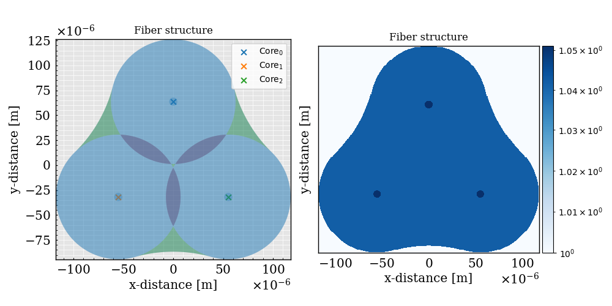

FiberFusing
===========

.. list-table::
   :width: 100%
   :widths: 35 65
   :header-rows: 1

   * - Badge
     - Status
   * - Python versions
     - |mps-python|
   * - Documentation
     - |mps-docs|
   * - Tests
     - |mps-ci| |mps-coverage|
   * - PyPI
     - |mps-pypi| |mps-downloads|
   * - Conda
     - |mps-conda| |mps-conda-downloads| |mps-conda-release|

Parametrized fused-fiber cross-sections and refractive-index meshes.

Start with a circular or linear arrangement of optical fibers and vary the fusion
degree to change the cladding boundary and core positions. Place catalog fibers
at those positions and rasterize the cross-section to obtain a two-dimensional
refractive-index mesh.

Run the `Colab notebook <https://colab.research.google.com/github/MartinPdeS/FiberFusing/blob/master/notebook.ipynb>`_
in your browser, or explore other arrangements in the
`example gallery <https://martinpdes.github.io/FiberFusing/docs/latest/gallery/index.html>`_.

Installation
------------

Requires Python ``>=3.10``.

.. code-block:: console

   $ python -m pip install FiberFusing

Install from the ``martinpdes`` Conda channel:

.. code-block:: console

   $ conda install -c martinpdes fiberfusing

For an editable source installation:

.. code-block:: console

   $ git clone https://github.com/MartinPdeS/FiberFusing.git
   $ cd FiberFusing
   $ python -m pip install -e .

Model a three-fiber ring
------------------------

Arrange three SMF28 fibers in air with a cladding radius of 62.5 µm and a
fusion degree of 0.4. The script uses meters for length and dimensionless
refractive indices. For headless use, ``geometry.plot(show=False)`` returns
the Matplotlib figure.

.. code-block:: python

   """
   3x3 Ring - Geometry Visualization
   =================================
   This script demonstrates how to create and visualize a 3x3 ring geometry using the FiberFusing library.
   """

   from FiberFusing import Geometry, DomainAlignment, BackGround
   from FiberFusing.fiber import FiberLoader
   from FiberFusing.profile import Profile, StructureType

   # Set up the background medium (air)
   air_background = BackGround(refractive_index=1.0)

   # Create the profile structure based on the fused fiber profile
   profile = Profile()

   profile.add_structure(
       structure_type=StructureType.CIRCULAR,
       number_of_fibers=3,
       fusion_degree=0.4,
       fiber_radius=62.5e-6,
   )

   profile.refractive_index = (
       1.4444  # Refractive index of silica at the specified wavelength
   )

   # Load fibers (e.g., SMF-28) positioned at the cores of the profile structure
   fiber_loader = FiberLoader()
   fibers = [
       fiber_loader.load_fiber(
           "SMF28", clad_refractive_index=profile.refractive_index, position=core_position
       )
       for core_position in profile.cores
   ]

   # Set up the geometry with the defined background, profile structure, and resolution
   geometry = Geometry(
       x_bounds=DomainAlignment.CENTERING,
       y_bounds=DomainAlignment.CENTERING,
       resolution=350,
   )

   # Add the fibers to the geometry
   geometry.add_structure(air_background, profile, *fibers)

   geometry.initialize()

   # Plot the resulting geometry
   geometry.plot()

   Three-fiber fused cross-section and its refractive-index mesh.

Documentation
-------------

Use the `FiberFusing documentation <https://martinpdes.github.io/FiberFusing/>`__ to work through
examples and look up the inputs and return values of individual functions.

Contributing
------------

Bug reports, worked examples, and documentation corrections are welcome.
To set up a development checkout and run the tests, follow the `contributing guide <https://github.com/MartinPdeS/FiberFusing/blob/HEAD/CONTRIBUTING.md>`__.

Contact
-------

For questions, contact `Martin Poinsinet de Sivry-Houle <mailto:martin.poinsinet.de.sivry@gmail.com?subject=FiberFusing>`__.
Report bugs on the `issue tracker <https://github.com/MartinPdeS/FiberFusing/issues>`__.

License
-------

FiberFusing is licensed under `MIT <https://github.com/MartinPdeS/FiberFusing/blob/HEAD/LICENSE>`__.

.. |mps-python| image:: https://img.shields.io/pypi/pyversions/fiberfusing.svg
   :alt: Supported Python versions
   :target: https://pypi.org/project/fiberfusing/

.. |mps-pypi| image:: https://img.shields.io/pypi/v/fiberfusing.svg
   :alt: PyPI version
   :target: https://pypi.org/project/fiberfusing/

.. |mps-downloads| image:: https://img.shields.io/pypi/dm/fiberfusing.svg
   :alt: Monthly PyPI downloads
   :target: https://pypistats.org/packages/fiberfusing

.. |mps-docs| image:: https://github.com/MartinPdeS/FiberFusing/actions/workflows/deploy_documentation.yml/badge.svg
   :alt: Documentation
   :target: https://martinpdes.github.io/FiberFusing/

.. |mps-ci| image:: https://github.com/MartinPdeS/FiberFusing/actions/workflows/tests.yml/badge.svg
   :alt: Tests
   :target: https://github.com/MartinPdeS/FiberFusing/actions/workflows/tests.yml

.. |mps-conda| image:: https://anaconda.org/martinpdes/fiberfusing/badges/version.svg
   :alt: Anaconda version
   :target: https://anaconda.org/martinpdes/fiberfusing

.. |mps-conda-downloads| image:: https://anaconda.org/martinpdes/fiberfusing/badges/downloads.svg
   :alt: Anaconda downloads
   :target: https://anaconda.org/martinpdes/fiberfusing

.. |mps-conda-release| image:: https://anaconda.org/martinpdes/fiberfusing/badges/latest_release_relative_date.svg
   :alt: Latest Anaconda release
   :target: https://anaconda.org/martinpdes/fiberfusing
