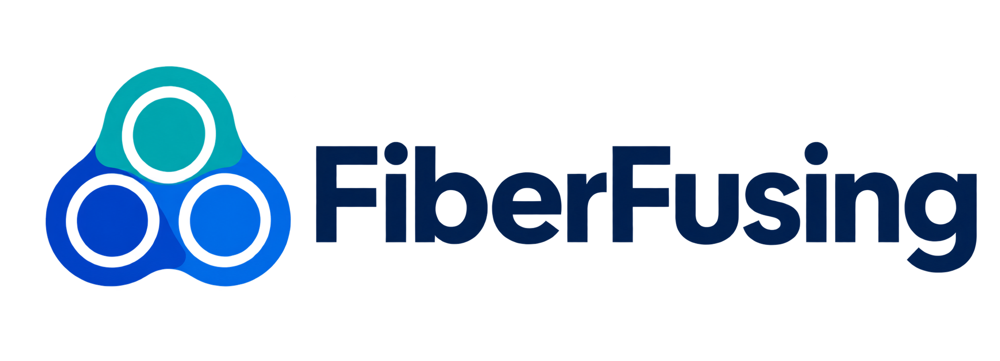
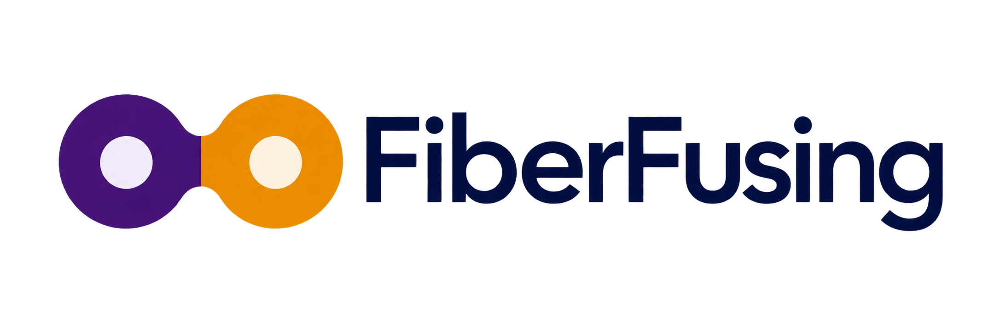
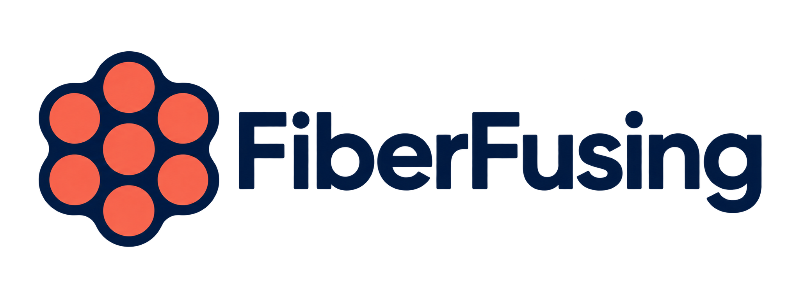
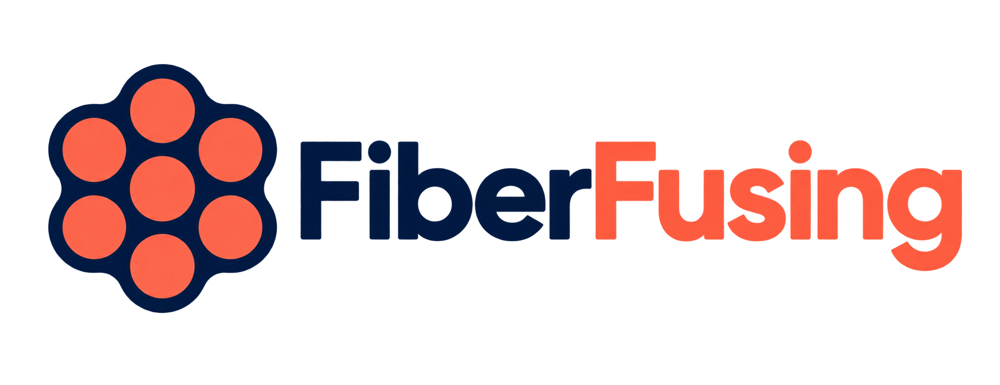

# FiberFusing branding candidates

Generated with the built-in image_gen tool. **Selected: option C, with the
two-color wordmark.** The README and Sphinx header use the navy/coral wordmark;
Sphinx uses the matching option C icon for gallery thumbnails and favicon mark
for browser tabs. Original candidates and generation prompts are preserved.

| Option | Design | Logo | Icon | Favicon |
| --- | --- | --- | --- | --- |
| A | Trefoil, teal and cobalt | [Logo](option-a/logo.png) | [Icon](option-a/icon.png) | [Favicon](option-a/favicon.png) |
| B | Fusion seam, violet and amber | [Logo](option-b/logo.png) | [Icon](option-b/icon.png) | [Favicon](option-b/favicon.png) |
| C | Hex bundle, coral and navy | [Logo](option-c/logo.png) | [Icon](option-c/icon.png) | [Favicon](option-c/favicon.png) |

Each option includes a horizontal wordmark, a square symbol, and a simplified
favicon mark. Assets are transparent PNGs. Favicon candidates are high-resolution
sources intended for small browser-tab display. Exact generation prompts and
reference relationships are retained in [prompts.json](prompts.json).

Open [preview.html](preview.html) for a side-by-side comparison on white backgrounds,
including favicons displayed at 16, 32, and 64 pixels.

## A: Trefoil

## B: Fusion seam

## C: Hex bundle

## C: two-color refinement

Selected-concept refinement: navy Fiber, coral Fusing, unchanged seven-core motif.

[Generation prompt](option-c/logo-two-color.prompt.txt). Original candidates are preserved.
